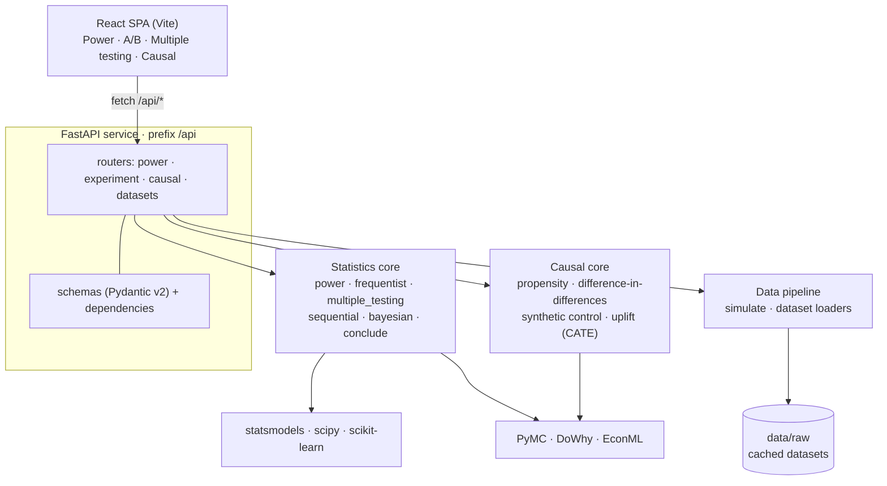

# Experimentation & Causal Inference Platform

An internal tool that helps teams **design A/B tests**, **analyse them correctly**, and
**estimate cause and effect when experiments are not possible**.

It answers three questions in one place:

1. **How big should my test be?** — power, sample-size and MDE calculation.
2. **What does my experiment say?** — frequentist, sequential (peek-safe) and Bayesian readouts.
3. **What if I can't run an experiment?** — propensity matching, difference-in-differences,
   synthetic control and uplift/CATE.

The stack is a pure-Python statistical engine (`src/core`), a FastAPI service (`src/api`), a
React single-page app (`frontend/`), a reproducible Jupyter-notebook suite (`notebooks/`) and
an automated test suite (`tests/`).

```
Design           Analyse                     Decide
──────           ───────                     ──────
power &     ──►  t-test · z-test · chi-square ──►  plain-English
sample size      sequential (peek-safe)            conclusion
                 Bayesian  P(B beats A)            + charts
                 ── when you cannot randomise ──
                 propensity · diff-in-diff · synthetic control · uplift
```

---

## Architecture



A more detailed rendered version is in [`docs/ARCHITECTURE.md`](docs/ARCHITECTURE.md).

### Layers

| Layer | Directory | Responsibility |
|---|---|---|
| **Presentation** | `frontend/src` | React SPA: upload or simulate data, pick a method, render charts and a plain-English conclusion |
| **Service** | `src/api` | HTTP surface: routers, Pydantic v2 request models, data-source resolution, CSV upload |
| **Core** | `src/core` | Pure, framework-free statistical and causal estimators; return structured results + a `conclusion` |
| **Data pipeline** | `src/data_pipeline` | Dataset loaders (real download → local cache → simulation fallback) and deterministic experiment simulators |

Dependency direction is strictly **one-way**: the front end only talks to `/api`; routers only
call the core and data layers; the core never imports FastAPI.

### Request lifecycle (worked example)

A user uploads a CSV on the **A/B Analysis** page and requests a Bayesian readout:

```
React page ──POST /api/analysis/bayesian {source:"upload", upload_id, metric...}──► router
   router ──► dependencies.resolve_dataframe()  (reads uploads/upload_id.csv)
          ──► core.bayesian.*                     (Beta-Binomial / Normal model)
          ──► core.conclude.*                      (headline + recommendation)
   router ◄── { result: {...}, conclusion: {...}, distribution: {...} }  ──► React charts
```

Every analysis response therefore carries a machine-readable `result` object **and** a
`conclusion` object (`headline`, `details`, `recommendation`) in plain English.

### Design principles

| Principle | How it shows up |
|---|---|
| **Portable paths** | Every path is built with `os.path.join` from a dynamically resolved `PROJECT_ROOT` ([`src/config.py`](src/config.py)), so the code runs identically on Windows/macOS/Linux and from both notebooks and the API |
| **Graceful degradation** | If PyMC is missing the Bayesian endpoints use exact conjugate posteriors; if EconML is missing the uplift endpoint uses a T-learner — the service never hard-fails |
| **Deterministic data** | Simulators are seeded, so notebooks, tests and demos are reproducible offline |
| **Explainability** | Numeric results are always paired with a plain-English `conclusion` layer (`src/core/conclude.py`) |

---

## Milestones → where they live

| # | What it covers | Where it lives |
|---|---|---|
| 1 | Hypothesis tests, p-values, power, confidence intervals | `src/core/power.py`, `src/core/frequentist.py`, `notebooks/01_*` |
| 2 | Power / sample-size calculator service (FastAPI) | `src/api/routers/power.py`, `notebooks/01_*` |
| 3 | Simulated data, t-test, chi-square, Bonferroni & Benjamini-Hochberg | `src/core/frequentist.py`, `src/core/multiple_testing.py`, `notebooks/02_*` |
| 4 | Sequential testing so teams can peek safely | `src/core/sequential.py`, `notebooks/03_*` |
| 5 | Bayesian A/B with PyMC (probability B beats A) | `src/core/bayesian.py`, `notebooks/04_*` |
| 6 | Propensity matching, diff-in-diff, synthetic control, uplift (DoWhy / EconML) | `src/core/causal/*`, `notebooks/05_*`, `notebooks/06_*` |
| 7 | React front end: upload data, pick a method, get a plain-English conclusion + charts | `frontend/` |

---

## Project structure

```
Experimentation and Causal Inference Platform/
├── src/
│   ├── config.py                 # PROJECT_ROOT + os.path.join path helpers
│   ├── core/                     # statistical engine (pure functions)
│   │   ├── power.py              # sample size, power, MDE
│   │   ├── frequentist.py        # Welch t-test, two-proportion z, chi-square
│   │   ├── multiple_testing.py   # Bonferroni, Benjamini-Hochberg, Holm, Šidák
│   │   ├── sequential.py         # alpha-spending + always-valid (mSPRT) p-values
│   │   ├── bayesian.py           # PyMC Beta-Binomial / Normal models
│   │   ├── conclude.py           # plain-English conclusions
│   │   └── causal/
│   │       ├── propensity.py     # PSM (+ DoWhy) with balance diagnostics
│   │       ├── did.py            # difference-in-differences (HC1 robust SE)
│   │       ├── synthetic_control.py
│   │       └── uplift.py         # CausalForestDML / T-learner, Qini, AUUC
│   ├── data_pipeline/
│   │   ├── datasets.py           # loaders for the 6 recommended datasets
│   │   └── simulate.py           # deterministic experiment simulators
│   └── api/
│       ├── main.py               # FastAPI app + lifespan + CORS
│       ├── schemas.py            # Pydantic v2 request models
│       ├── dependencies.py       # data-source resolution, CSV upload, arm split
│       └── routers/              # power · experiment · causal · datasets
├── frontend/
│   └── src/
│       ├── App.jsx               # 4 pages + navigation shell
│       ├── api/client.js         # typed fetch wrappers for /api
│       ├── pages/                # PowerCalculator · ABAnalysis · MultipleTesting · CausalInference
│       └── components/           # charts, DataSourcePanel, ConclusionCallout, ...
├── notebooks/                    # EDA / training notebooks (01-06)
├── tests/                        # pytest suite (31 tests)
├── data/raw/                     # cached datasets (created at runtime)
├── artifacts/                    # figures produced by the notebooks
├── requirements.txt
└── README.md
```

Every file path in the project is built with `os.path.join` from a dynamically resolved
`PROJECT_ROOT` (see [`src/config.py`](src/config.py)) so the code runs identically on
Windows, macOS and Linux and from both notebooks and the API.

---

## Quick start

### Backend (API + statistics + notebooks)

```bash
# 1. create and activate a virtual environment
python -m venv .venv
#   Windows:      .venv\Scripts\activate
#   macOS/Linux:  source .venv/bin/activate

# 2. install dependencies
pip install -r requirements.txt

# 3. run the tests
pytest -q

# 4. start the API (http://localhost:8000, interactive docs at /docs)
uvicorn src.api.main:app --reload --port 8000
```

> Already have an environment somewhere else (e.g. a shared `.venv` in a parent folder)?
> Point at its interpreter directly instead of activating, e.g.
> `..\.venv\Scripts\python.exe -m uvicorn src.api.main:app --reload --port 8000`.

> PyMC, DoWhy and EconML are used when present, but the platform degrades gracefully:
> the Bayesian endpoints fall back to exact conjugate posteriors and the uplift endpoint
> falls back to a T-learner, so the service always works.

### Frontend (React SPA)

```bash
cd frontend
npm install
npm run dev          # http://localhost:5173  (proxies /api to :8000)
```

Open <http://localhost:5173> **with the API running**. The dev server proxies `/api` to
`http://localhost:8000`, so no CORS configuration is needed.

### Notebooks

```bash
jupyter lab notebooks/
```

Six notebooks walk through every milestone (see below). They read/write files through the
`src.config` path helpers, so they work from any working directory.

---

## Notebooks

| Notebook | Focus |
|---|---|
| `01_power_and_sample_size.ipynb` | Power curves, sample size vs. lift, MDE, continuous & proportion metrics |
| `02_frequentist_ab_analysis.ipynb` | t-test, z-test, chi-square, multiple-testing correction, **Cookie Cats** |
| `03_sequential_testing.ipynb` | O'Brien-Fleming vs. Pocock boundaries, always-valid p-values |
| `04_bayesian_ab.ipynb` | Beta-Binomial & Normal-Normal PyMC models, P(B beats A), expected loss |
| `05_causal_inference.ipynb` | PSM (+ DoWhy refutation), **Card & Krueger** DiD, **Prop 99** synthetic control |
| `06_uplift_modeling.ipynb` | CATE on **Hillstrom** & **IHDP**, Qini curves, AUUC |

---

## Datasets

Loaders live in [`src/data_pipeline/datasets.py`](src/data_pipeline/datasets.py). Each one
prefers a real download (kagglehub / public URL / bundled package), caches the result to
`data/raw/`, and falls back to a structurally identical simulation so notebooks and tests
always run offline.

| Key | Dataset | Used for |
|---|---|---|
| `cookie_cats` | Cookie Cats mobile-game A/B test (Kaggle) | binary A/B analysis |
| `hillstrom` | Hillstrom e-mail marketing experiment | uplift / CATE |
| `lalonde` | LaLonde NSW job-training data | propensity matching |
| `card_krueger` | Card & Krueger minimum-wage panel | difference-in-differences |
| `prop99` | California Proposition 99 tobacco panel | synthetic control |
| `ihdp` | IHDP semi-synthetic benchmark | heterogeneous effects |

Simulated experiment data (continuous, binary, multi-metric, sequential, confounded) is
generated in [`src/data_pipeline/simulate.py`](src/data_pipeline/simulate.py).

---

## API

All routes are served under `/api`. Full request/response documentation is in
[`docs/API.md`](docs/API.md); live OpenAPI docs are at `/docs` when the server is running.

| Method | Endpoint | Purpose |
|---|---|---|
| `POST` | `/api/power/sample-size` | required sample size per arm |
| `POST` | `/api/power/power` | statistical power for a fixed n |
| `POST` | `/api/power/mde` | minimum detectable effect |
| `POST` | `/api/analysis/frequentist` | t-test / two-proportion z-test |
| `POST` | `/api/analysis/multiple-testing` | Bonferroni & Benjamini-Hochberg |
| `POST` | `/api/analysis/sequential` | peek-safe sequential analysis |
| `POST` | `/api/analysis/bayesian` | P(B beats A) + expected loss |
| `POST` | `/api/causal/propensity` | propensity-score matching (optionally DoWhy) |
| `POST` | `/api/causal/did` | difference-in-differences ATT |
| `POST` | `/api/causal/synthetic-control` | synthetic-control effect |
| `POST` | `/api/causal/uplift` | CATE + Qini/AUUC |
| `GET` | `/api/datasets` | list bundled datasets |
| `GET` | `/api/datasets/{name}` | load a dataset preview |
| `POST` | `/api/datasets/simulate` | generate a simulated dataset |
| `POST` | `/api/datasets/upload` | upload a CSV, returns an `upload_id` |
| `GET` | `/api/health` | liveness probe |

---

## Tech stack

| Tool | Role |
|---|---|
| **statsmodels** | power/sample size, t-test, z-test, chi-square, multiple-testing corrections, DiD OLS |
| **PyMC** | Bayesian A/B models (Beta-Binomial / Normal-Normal) |
| **DoWhy** | propensity-score matching estimator + refutation tests |
| **EconML** | `CausalForestDML` uplift / CATE modelling |
| **FastAPI** | HTTP service (Pydantic v2 schemas, CORS, OpenAPI docs) |
| **React + Vite + Recharts** | single-page app, dev proxy and charts |

---

## Tests

```bash
pytest -q
```

```
31 passed, 1 warning
```

The suite covers the power calculator, frequentist tests, multiple-testing corrections,
sequential boundaries and always-valid p-values, Bayesian models, every causal estimator
(including recovery of known simulated effects) and the FastAPI endpoints end-to-end.

---

## Deliverables map

* **Working demo** – FastAPI service + React SPA (`uvicorn src.api.main:app` + `npm run dev`).
* **GitHub repo** – clean module layout, README, `requirements.txt`, setup instructions.
* **Architecture & docs** – `docs/ARCHITECTURE.md`, `docs/API.md`, this README.
* **Test results / numbers** – `pytest -q` (31 passed); known-effect checks in
  `tests/test_causal.py` (DiD recovers ≈1.59 vs. true 1.5; PSM reduces confounding bias).
* **Presentation & reflection** – notebooks 01-06 summarise results per milestone.
